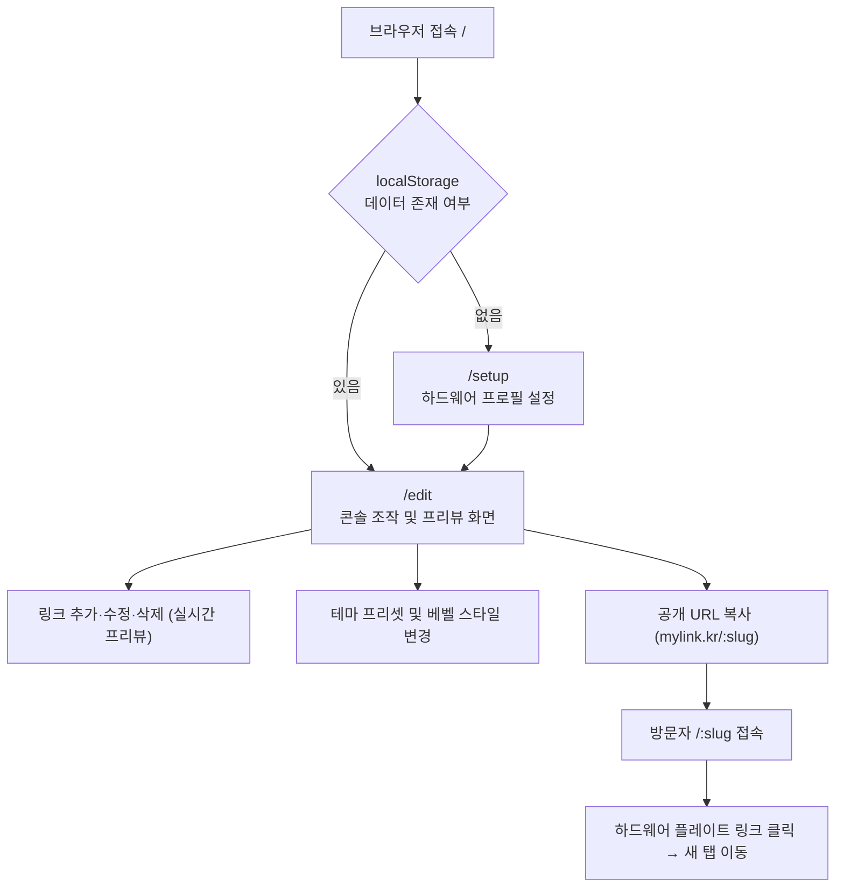

# 마이링크(My Link) — 제품 요구사항 정의서 (PRD)

> **버전** v1.4 · **작성일** 2026-11-15 · **단계** Phase 1 — 프로필 페이지 & shadcn/ui 콘솔 하드웨어 디자인 시스템

---

## 1. 개요

### 1.1 서비스 소개

**마이링크**는 누구나 하나의 링크로 자신의 모든 SNS·콘텐츠·연락처를 모아 보여줄 수 있는 개인 링크 허브 서비스입니다. 별도 서버 없이 브라우저의 `localStorage`를 활용해 가입 없이도 빠르게 나만의 페이지를 만들 수 있습니다.

### 1.2 디자인 콘셉트: Y2K 콘솔 하드웨어 × shadcn/ui

본 프로젝트의 시각적 아이덴티티는 **2001년경 닌텐도 하드웨어(Nintendo.com circa 2001)** 인터페이스에서 영감을 받은 **‘웹 콘솔 하드웨어(Web Console Hardware)’** 테마를 채택합니다.
- 부드러운 현대식 플랫/머티리얼 디자인 대신, 사출 성형 플라스틱 및 브러시드 페리윙클 메탈 플레이트, 각진 45도 챔퍼(Chamfered) 지오메트리, 음각/양각 베벨 플레이트, 카본 하프톤 도트 매트릭스 텍스처를 구현합니다.
- 기반 컴포넌트 엔진은 모던 접근성과 표준 웹 규격을 완벽히 준수하는 **shadcn/ui (Tailwind CSS v4 기반)**를 사용하여, 견고한 하드웨어 스킨을 입힌 커스텀 디자인 시스템을 구축합니다.

### 1.3 목표

| 항목 | 내용 |
|------|------|
| 주요 타겟 | 일반 개인 사용자 (크리에이터, 개발자, 디자이너, 학생 등) |
| 수익 모델 | 무료 (MVP 단계, 수익화는 추후 검토) |
| 인증 방식 | 로컬 스토리지 기반 (서버 계정 없음, Zero-Backend) |
| 지원 환경 | PC + 모바일 반응형 (320px ~ 1920px) |
| 디자인 시스템 | shadcn/ui + Tailwind CSS v4 (Zero-Config, CSS-First) + 콘솔 하드웨어 토큰 |
| **스타일링 원칙** | **CSS Modules (`*.module.css`) 사용을 전면 배제하고 Tailwind CSS v4 단독 통일** |
| **컴포넌트 원칙** | **Design.md 기반 shadcn/ui 하드웨어 컴포넌트 (`src/components/ui/`) 공통 재사용 체계** |
| **데이터 원칙** | **공식 더미 데이터 단독 사용 (`src/data/mockLinks.ts`의 `DUMMY_LINKS` 8종 고정 바인딩)** |

---

## 2. 사용자 시나리오

### 시나리오 A — 처음 방문하는 신규 사용자
> **페르소나**: 김지수 (25세, 프리랜서 디자이너)  
> 인스타그램·노션 포트폴리오·카카오 오픈채팅 링크를 하나로 묶고 싶다.

1. `mylink.kr` 접속 → 2001 하드웨어 감성의 시작 페이지에서 서비스 소개 확인
2. **[시작하기 (START)]** 시그널 오렌지 버튼 클릭 → `/setup` 이동
3. 슬러그 `jisoo-design` 입력, 이름 "김지수", 소개 "프리랜서 UI 디자이너 🎨" 작성
4. 프로필 사진 업로드 → **[완료 (CONFIRM)]** 클릭
5. `/edit` 편집 화면 진입 (좌측 베벨 플레이트 편집기 / 우측 콘솔 프레임 프리뷰)
6. **[링크 추가]** → Instagram 아이콘 선택, "내 인스타그램" 입력, URL 붙여넣기 → 우측 프리뷰에 즉시 반영
7. 같은 방식으로 노션 포트폴리오, 카카오 오픈채팅 링크 추가
8. 상단 "저장됨 ✓" 확인 후 공개 URL `mylink.kr/jisoo-design` 복사

---

### 시나리오 B — 기존 사용자가 링크를 수정하는 경우
> **페르소나**: 박민준 (32세, 유튜버)  
> 기존에 등록한 유튜브 링크 URL이 바뀌어 수정이 필요하다.

1. `mylink.kr` 재접속 → localStorage 데이터 감지 → `/edit` 자동 이동
2. 링크 목록에서 "유튜브 채널" 베벨 카드 확인
3. 인셋 인풋 필드 클릭 → 새 URL로 수정
4. 1초 후 디바운스 자동 저장 → "저장됨 ✓" 인디케이터 확인
5. 우측 프리뷰에서 실시간 갱신 확인

---

### 시나리오 C — 방문자가 공개 페이지를 보는 경우
> **페르소나**: 이수연 (28세, 디자인 클라이언트)  
> 김지수의 SNS에서 마이링크 URL을 받아 접속한다.

1. `mylink.kr/jisoo-design` 접속
2. 콘솔 페이스플레이트 질감의 프로필 사진·이름·소개 문구 확인
3. 소셜 아이콘 바에서 Instagram 아이콘 클릭 → 새 탭 이동
4. 챔퍼드 베벨 링크 플레이트 클릭 → 포트폴리오 사이트로 이동

---

### 시나리오 D — 링크를 임시 비활성화하는 경우
> **페르소나**: 박민준 (32세, 유튜버)  
> 아직 비공개인 영상을 링크 목록에서 숨기고 싶다.

1. `/edit` 화면에서 대상 링크의 토글 스위치(Hardware Rocker Switch) OFF 전환
2. 우측 프리뷰에서 해당 링크 카드 즉시 제거 확인
3. 자동 저장 완료 → 공개 페이지(`/:slug`)에서도 미노출

---

### 시나리오 E — 링크를 실수로 삭제한 경우
> **페르소나**: 김지수 (25세, 프리랜서 디자이너)  
> 실수로 삭제 버튼을 눌렀다.

1. 링크 카드의 삭제 버튼 클릭 → 목록에서 즉시 제거
2. 하단에 shadcn/ui 기반 **[실행 취소 (UNDO)]** 토스트 알림 3초간 노출
3. 3초 이내 [실행 취소] 클릭 → 링크 복원
4. 3초 초과 시 삭제 확정 및 자동 저장

---

## 3. 화면 목록 (페이지 구조)

```
✅ Phase 1 (현재)
/                   → 시작 페이지 (콘솔 하드웨어 인트로 + START 버튼)
/setup              → 최초 설정 (슬러그·프로필 입력 카트리지 폼)
/edit               → 편집 화면 (베벨 인셋 패널 + 실시간 모바일 콘솔 프리뷰)
/:slug              → 공개 링크 페이지 (방문자용 페이스플레이트 허브)

🔒 Phase 2 이후 (예정)
/dashboard          → 통계 대시보드
```

---

## 4. 디자인 시스템 명세 (shadcn/ui × Design.md Console Hardware)

### 4.1 시각 원칙 (Design Philosophy)

1. **조립된 하드웨어 페이스플레이트 (Assembled Machine Faceplate)**
   * 각 UI 영역은 소프트한 카드가 아니라 **사출 성형된 베벨 메탈 플레이트**처럼 조립됩니다. 상단/좌측의 하이라이트 엣지와 하단/우측의 섀도우 라인으로 입체감을 형성합니다.
2. **챔퍼드 지오메트리 (Chamfered Cut Corners)**
   * 주요 대형 모듈 및 패널은 둥근 모서리(Border Radius) 대신 **45도 각도로 커팅된 챔퍼드 코너(`clip-path: polygon(...)`)**를 기본 형상으로 사용합니다. 라운딩은 특정 뱃지나 버튼 칩, 라디오 토글 등 기능적 요소에만 한정적으로 적용합니다.
3. **엄격한 3가지 보이스 컬러 시스템 (Three-Voice Palette)**
   * **구조적 보이스 (Structural)**: 쿨 페리윙클-인디고 크롬 계열 (`canvas`, `periwinkle`, `chrome-indigo`, `chrome-highlight`). 모든 본체와 섀시를 구성.
   * **권위/명령 보이스 (Authority)**: 카본 네이비(`carbon`) + 하프톤 도트 매트릭스 텍스처. 상단 커맨드 바, 우측 액션 레일, 푸터 등 제어 영역에 적용.
   * **에너지/신호 보이스 (Energy / Action Only)**: 웜톤은 오직 **길 안내와 행동 유도(Wayfinding & Action)**에만 사용.
     * `signal` (오렌지 #f68d1f): 전진, 제출, 실행, 이동 화살표
     * `amber` (앰버 #ecab37): 유틸리티 칩, 뱃지, 상태 표시
     * `nav-gold` (골드 #e48600): 주 탐색 텍스트 및 활성 인디케이터
4. **촉각적 인셋 웰 (Tactile Inset Wells)**
   * 입력창, 리스트 슬롯, 검색창 등 입력을 받는 영역은 안쪽으로 깊숙이 파인 **인셋 플레이트(Inset Plate)**로 표현하여 부품이 삽입된 하드웨어 느낌을 전달합니다.
5. **CSS Modules 전면 배제 및 Tailwind CSS v4 단독 통일 원칙 (Zero CSS Modules Policy)**
   * 본 프로젝트의 모든 스타일링은 유지보수성과 컴포넌트 일관성을 위해 별도의 CSS Modules(`*.module.css`)를 일절 생성하거나 사용하지 않으며, **Tailwind CSS v4 유틸리티 클래스 및 `@theme` 기반 글로벌 토큰으로만 작성하여 스타일을 단일 표준화**합니다.
6. **Design.md 기반 shadcn/ui 하드웨어 컴포넌트 재사용 아키텍처 (Reusable Hardware UI Kit)**
   * `src/components/ui/` 디렉토리에 shadcn/ui 프리미티브를 확장한 콘솔 하드웨어 컴포넌트(`Button`, `Card`, `Badge`, `Input`, `Switch`, `Avatar`, `Tabs` 등)를 구축하여, 페이지 전반에서 레고 블록 형태로 조합·재사용합니다. 인라인 중복 스타일 선언을 지양하고 공통 UI 컴포넌트를 호출하여 하드웨어 테마의 일관성을 보장합니다.

---

### 4.2 디자인 토큰 정의 (Tailwind CSS v4 & CSS Variables)

```css
/* src/app/globals.css 기반 토큰 매핑 */
:root {
  /* 1. Structural Chrome */
  --canvas: #7a8aba;              /* 메인 섀시 베이스 */
  --periwinkle: #8ba1d4;          /* 중간 톤 페리윙클 */
  --canvas-soft: #9fbee7;         /* 부드러운 플레이트 하이라이트 */
  --lavender: #acace7;            /* 보조 파스텔 틴트 */
  --chrome-indigo: #3d4f97;       /* 섀도우 & 베벨 경계선 */
  --chrome-highlight: #b8c7ee;    /* 상단/좌측 에지 광택선 */
  --muted-indigo: #60619c;        /* 비활성 텍스트 / 보조 크롬 */
  --platinum: #dedede;            /* 하이라이트 플레이트 */

  /* 2. Authority & Body */
  --carbon: #21242e;              /* 커맨드 바 & 스피커 그릴 카본 */
  --ink: #21242e;                 /* 본문 폰트 기본 컬러 */
  --ink-soft: #3d4f97;            /* 보조 라벨 폰트 */

  /* 3. Energy & Action (Wayfinding Only) */
  --signal: #f68d1f;              /* Primary Action / Forward CTA */
  --amber: #ecab37;               /* Utility Badge / Chips */
  --nav-gold: #e48600;            /* Nav Items / Emphasis */

  /* shadcn/ui 시맨틱 토큰 매핑 */
  --background: #556288;
  --foreground: #21242e;
  --card: #7a8aba;
  --card-foreground: #21242e;
  --popover: #8ba1d4;
  --popover-foreground: #21242e;
  --primary: #f68d1f;             /* Signal Orange */
  --primary-foreground: #ffffff;
  --secondary: #21242e;           /* Carbon Navy */
  --secondary-foreground: #ffffff;
  --muted: #8ba1d4;
  --muted-foreground: #3d4f97;
  --accent: #ecab37;              /* Amber */
  --accent-foreground: #21242e;
  --destructive: oklch(0.577 0.245 27.325);
  --border: #3d4f97;
  --input: #3d4f97;
  --ring: #f68d1f;
  --radius: 0px;                  /* 기본 챔퍼드 & 샤프 지오메트리 */
}
```

---

### 4.3 하드웨어 유틸리티 클래스 체계

* `.bevel-plate`:
  * 상단/좌측 `2px solid #b8c7ee`, 하단/우측 `2px solid #3d4f97`. (성형 플라스틱 볼륨감)
* `.inset-plate`:
  * 상단/좌측 `2px solid #3d4f97`, 하단/우측 `2px solid #ffffff`. (음각 입력창 및 홈)
* `.chamfered-box`:
  * `clip-path: polygon(10px 0%, calc(100% - 10px) 0%, 100% 10px, 100% calc(100% - 10px), calc(100% - 10px) 100%, 10px 100%, 0% calc(100% - 10px), 0% 10px);`
* `.carbon-halftone`:
  * 다크 카본 배경에 0.8px 도트 매트릭스 라디얼 패턴 (스피커 그릴 / 커맨드 슬래브)
* `body` 패턴:
  * 45도 다이아몬드 미세 그리드 패턴 (#556288 베이스)

---

### 4.4 shadcn/ui 컴포넌트 하드웨어 스킨 매핑 테이블

| shadcn/ui 컴포넌트 | 적용 페이지 / 위치 | 하드웨어 디자인 시스템 스타일 변환 규칙 |
|-------------------|-------------------|-----------------------------------|
| **Button** | 전체 (시작, 링크 추가, 저장, 삭제 등) | • **default/primary**: Signal Orange fill + bevel 테두리 + 누를 때 `translate-y-px`<br>• **secondary**: Carbon Navy (`carbon-halftone`) + 화이트 텍스트<br>• **outline**: Chrome Indigo 보더 + Canvas 플레이트<br>• **ghost**: 음각 인셋 호버 효과 |
| **Card** | 프로필 박스, 링크 아이템, 프리뷰 프레임 | • `.chamfered-box` + `.bevel-plate` 결합<br>• 배경은 `--canvas` 또는 `--canvas-soft`<br>• 상단 헤더에 슬릿(Slit) 또는 리벳 장식 라인 적용 |
| **Input / Textarea** | `/setup`, `/edit` 입력 필드 | • `.inset-plate` 음각 웰 스타일 적용<br>• 배경 `#8ba1d4` / 텍스트 `#21242e`<br>• 포커스 시 `--signal` 오렌지 하이라이트 링 |
| **Switch** | 링크 활성/비활성 토글 | • 하드웨어 락커 스위치(Rocker Switch) 형태<br>• 트랙은 카본 슬롯(`.inset-plate`), 썸(Thumb)은 앰버/시그널 오렌지 비즈 |
| **Avatar** | 프로필 사진 | • 원형 또는 모서리 챔퍼드 배지 프레임<br>• 외곽에 2px `--chrome-highlight` 림 및 음각 베젤 |
| **Dialog / Modal** | 사진 업로드, 중요 알림 팝업 | • 오버레이는 반투명 인디고 스크린<br>• 다이얼로그 바디는 챔퍼드 카본 슬래브 또는 대형 베벨 플레이트 |
| **Toast (Sonner)** | 링크 삭제 실행취소(Undo), 복사 완료 | • 카트리지 팩 형상의 베벨 알림 바<br>• 시그널 오렌지 색상의 인라인 [실행 취소] 버튼 탑재 |
| **Tabs** | 모바일 편집/프리뷰 전환 | • 하드웨어 셀렉터 스위치 바<br>• 선택된 탭은 양각 베벨 플레이트로 융기, 미선택 탭은 인셋 평면 |
| **Badge** | 상태 표시 ("저장됨", 카테고리) | • 앰버(`#ecab37`) 또는 골드(`#e48600`) 바탕의 실크스크린 라벨 느낌 |

---

## 5. 기능 명세

### 5.1 시작 페이지 (`/`)
- 콘솔 머신 전면 인트로 UI
- **[START (시작하기)]** 버튼 (`Button variant="default"`): Signal Orange + 입체 베벨
- localStorage 데이터 존재 여부에 따라 `/setup` 또는 `/edit` 분기 이동

### 5.2 최초 설정 페이지 (`/setup`)
- 챔퍼드 메인 폼 카트리지 내에서 단계별 정보 입력
- **입력 항목**:
  - 슬러그 (URL): 3~30자 영문/숫자/하이픈 (`Input`)
  - 닉네임: 표시 이름 (`Input`)
  - 소개 문구: 프로필 소개 (`Textarea`)
  - 프로필 사진: 이미지 업로드 (`Avatar` + `Input[type=file]`)
- **[CONFIRM (설정 완료)]** 클릭 시 localStorage 저장 후 `/edit` 이동

### 5.3 편집 페이지 (`/edit`)
- **레이아웃**:
  - **PC**: 좌측 조작 콘솔 패널 (2/3) + 우측 실시간 모바일 뷰파인더 프리뷰 (1/3)
  - **모바일**: 상단 `Tabs`를 통한 [조작 콘솔 ↔ 뷰파인더 프리뷰] 즉각 전환
- **프로필 편집**: 인라인 클릭 즉시 수정 가능한 인셋 인풋
- **링크 관리 (공식 더미 데이터 단독 사용)**:
  - **데이터 공급 원칙**: 프로젝트 내 정의된 `src/data/mockLinks.ts`의 공식 더미 데이터(`DUMMY_LINKS`) 8종만을 단독으로 사용합니다. 임의의 외부 링크나 무작위 생성 데이터는 사용하지 않습니다.
  - **[+ ADD LINK]** 버튼으로 링크 카드 추가
  - 링크 카드 구성: SNS/링크 아이콘 드롭다운, 제목, URL, 하드웨어 락커 `Switch`
  - 삭제 클릭 시 즉시 제거 및 3초 `Toast` [실행 취소] 노출
- **테마 / 배경 커스터마이징**:
  - 하드웨어 프리셋 테마 제공 (라벤더 크롬, 카본 다크, 게임보이 컬러 등)
  - 버튼 베벨 강도 및 챔퍼드 스타일 선택
- **소셜 아이콘 바**:
  - 지원: Instagram, YouTube, X, TikTok, GitHub, LinkedIn, 카카오톡, 블로그
  - URL 입력 시 해당 브랜드 아이콘 자동 하드웨어 배지화
- **자동 저장**:
  - 1초 디바운스 후 localStorage 동기화
  - 상단 패널에 "SYSTEM READY / SAVED ✓" 상태 인디케이터

### 5.4 공개 링크 페이지 (`/:slug`)
- 방문자 전용 최종 하드웨어 허브
- 슬러그 매칭 실패 시 404 콘솔 오류 화면 출력
- **데이터 소스**: 공식 더미 데이터(`src/data/mockLinks.ts`의 `DUMMY_LINKS`) 중 활성화(`active: true`)된 항목만을 플레이트로 렌더링
- **표시 순서**:
  1. 프로필 배지 (`Avatar`)
  2. 이름 및 실크스크린 소개 문구
  3. 소셜 아이콘 배지 열
  4. 활성화된 링크 베벨 플레이트 리스트 (클릭 시 새 탭 이동)

---

## 6. 비기능 요구사항

| 항목 | 기준 |
|------|------|
| **로딩 속도** | LCP 1.5초 이내 (Next.js Turbopack 정적 내보내기 최적화) |
| **접근성 (a11y)** | WAI-ARIA 준수 (shadcn/ui 기반 키보드 포커스 링, 스크린 리더 라벨 지원) |
| **반응형 대응** | 320px 모바일 화면부터 1920px 데스크톱까지 일관된 챔퍼드 배율 유지 |
| **저장 용량** | 브라우저 localStorage 최대 5MB 이내 관리 |
| **브라우저 호환성** | Chrome, Edge, Safari, Firefox 최신 버전 완벽 지원 |

---

## 7. 기술 스택

| 영역 | 기술 스택 | 버전 / 비고 |
|------|-----------|-------------|
| **프레임워크** | Next.js (App Router) | 16.3.x (`output: 'export'`) |
| **코어 런타임** | React / React DOM | 19.2.x |
| **언어** | TypeScript | 5.9.x |
| **스타일링** | Tailwind CSS | **v4.3.x** (CSS-first, `@theme` 토큰, **CSS Modules 전면 배제 및 Tailwind 단독 일원화**) |
| **디자인 시스템** | shadcn/ui | **v4.23.x** (Design.md 명세 기반 하드웨어 컴포넌트 라이브러리 재사용 체계) |
| **유틸리티** | `clsx` + `tailwind-merge` | `cn()` 헬퍼 유틸리티 |
| **애니메이션** | `tw-animate-css` | v1.4.x |
| **아이콘** | `lucide-react` | v1.73.x (시스템) + Simple Icons/SVG (SNS) |
| **저장소** | 브라우저 `localStorage` | Zero-Backend 아키텍처 |

---

## 8. 데이터 구조 및 공식 더미 데이터 명세

### 8.1 공식 더미 데이터 단독 사용 원칙 (Fixed Mock Data Policy)
- **단독 사용 규정**: 본 프로젝트는 `src/data/mockLinks.ts`에 정의된 **공식 더미 데이터(`DUMMY_LINKS`, `MOCK_MYLINK_DATA`)만을 링크 목록 및 프로필 데이터로 사용**합니다.
- **임의 데이터 배제**: 외부 API 호출이나 임의의 무작위 데이터 입력을 배제하고, 사전에 엄격히 정의된 8종의 링크 항목만을 일관되게 바인딩하여 렌더링, 검색, 카테고리 필터링(`projects`, `skills`, `codes`, `social`, `contact`) 및 토글 동작을 검증합니다.
- **초기 상태 주입**: 브라우저 `localStorage("mylink_data")`가 비어있을 경우, `src/data/mockLinks.ts`의 `MOCK_MYLINK_DATA`를 기본값으로 주입하여 즉시 완전한 콘솔 인터페이스를 경험할 수 있도록 합니다.

### 8.2 공식 링크 목록 더미 데이터 명세 (`DUMMY_LINKS` 8종)

| ID | 제목 (Title) | 대상 URL | 카테고리 | 아이콘 | 활성 여부 | 설명 (Description) |
|---|---|---|---|---|---|---|
| `link-01` | GitHub Portfolio & Repositories | `https://github.com/young7297` | `codes` | `github` | `true` | 진행 중인 오픈소스 프로젝트와 개인 토이 프로젝트 코드 저장소 |
| `link-02` | MyLink 2001 Console Edition | `https://young7297.github.io/mylink` | `projects` | `gamepad` | `true` | Next.js 16 & Tailwind CSS v4 기반 Y2K 콘솔 하드웨어 감성의 링크 허브 웹앱 |
| `link-03` | Tech Devlog & Troubleshooting | `https://velog.io/@young7297` | `skills` | `book-open` | `true` | React 19 비동기 최적화 및 모던 프론트엔드 아키텍처 학습 기록 블로그 |
| `link-04` | Interactive Web Resume (Notion) | `https://notion.so/dayoung-resume` | `projects` | `file-text` | `true` | 상세 이력서, 기술 스택 명세서, 업무 역량 및 프로젝트 회고 문서 |
| `link-05` | LinkedIn Profile | `https://www.linkedin.com/in/dayoung-yoon` | `social` | `linkedin` | `true` | 글로벌 네트워크 및 커리어 이력 연결 |
| `link-06` | Design System & Figma Kit | `https://figma.com/@dayoung-console-ui` | `skills` | `figma` | `true` | 2001 하드웨어 챔퍼드 베벨 디자인 토큰 및 UI 컴포넌트 라이브러리 |
| `link-07` | Direct Email Inquiry (Gmail) | `mailto:ydo9902@gmail.com` | `contact` | `mail` | `true` | 프로젝트 협업, 채용 문의 및 커피챗 다이렉트 메일 |
| `link-08` | Kakao Open Chat (1:1 Quick Talk) | `https://open.kakao.com/me/dayoung-dev` | `contact` | `message-circle` | `false` | 실시간 빠른 문의 및 소통 채널 (비활성화 테스트 항목) |

### 8.3 localStorage 스키마 (`mylink_data`)

```json
// localStorage key: "mylink_data" (src/data/mockLinks.ts -> MOCK_MYLINK_DATA 기준)
{
  "slug": "dayoung",
  "profile": {
    "name": "Yoon Dayoung (윤다영)",
    "bio": "Gorgeous graphics, tactile feedback, and intuitive user experiences engineered for modern web.",
    "jobTitle": "Junior Frontend Developer",
    "location": "Seoul, Korea",
    "avatarUrl": "/mario-welcome.svg"
  },
  "theme": {
    "preset": "periwinkle-chrome",
    "bgColor": "#556288",
    "bevelStyle": "sharp-chamfer",
    "accentColor": "#f68d1f"
  },
  "socials": {
    "github": "https://github.com/young7297",
    "blog": "https://velog.io/@young7297",
    "linkedin": "https://www.linkedin.com/in/dayoung-yoon",
    "email": "ydo9902@gmail.com"
  },
  "links": [
    {
      "id": "link-01",
      "title": "GitHub Portfolio & Repositories",
      "url": "https://github.com/young7297",
      "description": "진행 중인 오픈소스 프로젝트와 개인 토이 프로젝트 코드 저장소",
      "category": "codes",
      "icon": "github",
      "active": true,
      "order": 0,
      "createdAt": "2026-11-01T09:00:00Z"
    },
    {
      "id": "link-02",
      "title": "MyLink 2001 Console Edition",
      "url": "https://young7297.github.io/mylink",
      "description": "Next.js 16 & Tailwind CSS v4 기반 Y2K 콘솔 하드웨어 감성의 링크 허브 웹앱",
      "category": "projects",
      "icon": "gamepad",
      "active": true,
      "order": 1,
      "createdAt": "2026-11-03T14:30:00Z"
    },
    {
      "id": "link-03",
      "title": "Tech Devlog & Troubleshooting",
      "url": "https://velog.io/@young7297",
      "description": "React 19 비동기 최적화 및 모던 프론트엔드 아키텍처 학습 기록 블로그",
      "category": "skills",
      "icon": "book-open",
      "active": true,
      "order": 2,
      "createdAt": "2026-11-05T11:20:00Z"
    },
    {
      "id": "link-04",
      "title": "Interactive Web Resume (Notion)",
      "url": "https://notion.so/dayoung-resume",
      "description": "상세 이력서, 기술 스택 명세서, 업무 역량 및 프로젝트 회고 문서",
      "category": "projects",
      "icon": "file-text",
      "active": true,
      "order": 3,
      "createdAt": "2026-11-08T18:00:00Z"
    },
    {
      "id": "link-05",
      "title": "LinkedIn Profile",
      "url": "https://www.linkedin.com/in/dayoung-yoon",
      "description": "글로벌 네트워크 및 커리어 이력 연결",
      "category": "social",
      "icon": "linkedin",
      "active": true,
      "order": 4,
      "createdAt": "2026-11-10T10:15:00Z"
    },
    {
      "id": "link-06",
      "title": "Design System & Figma Kit",
      "url": "https://figma.com/@dayoung-console-ui",
      "description": "2001 하드웨어 챔퍼드 베벨 디자인 토큰 및 UI 컴포넌트 라이브러리",
      "category": "skills",
      "icon": "figma",
      "active": true,
      "order": 5,
      "createdAt": "2026-11-12T16:40:00Z"
    },
    {
      "id": "link-07",
      "title": "Direct Email Inquiry (Gmail)",
      "url": "mailto:ydo9902@gmail.com",
      "description": "프로젝트 협업, 채용 문의 및 커피챗 다이렉트 메일",
      "category": "contact",
      "icon": "mail",
      "active": true,
      "order": 6,
      "createdAt": "2026-11-13T12:00:00Z"
    },
    {
      "id": "link-08",
      "title": "Kakao Open Chat (1:1 Quick Talk)",
      "url": "https://open.kakao.com/me/dayoung-dev",
      "description": "실시간 빠른 문의 및 소통 채널",
      "category": "contact",
      "icon": "message-circle",
      "active": false,
      "order": 7,
      "createdAt": "2026-11-14T08:20:00Z"
    }
  ]
}
```

---

## 9. 화면 흐름도 (User Flow)



---

## 10. 개발 스프린트 계획 (Phase 1)

| 스프린트 | 마일스톤 | 산출물 |
|----------|----------|--------|
| **S1 (완료)** | shadcn/ui & Tailwind v4 초기화 및 디자인 시스템 설계 | `components.json`, `globals.css` 토큰 세팅, PRD v1.3 |
| **S2 (완료)** | shadcn/ui 기반 하드웨어 컴포넌트 프리미티브 확장 (Design.md 명세) | Button, Card, Badge, Input, Switch, Avatar, Tabs 하드웨어 스킨 구축 (CSS Modules 배제 & Tailwind 단독 통일) |
| **S3** | `/setup` 및 `/edit` 화면 구현 | 프로필·링크 CRUD 인터페이스, 로컬스토리지 연동, 자동 저장 |
| **S4 (진행중)** | 실시간 프리뷰 & `/:slug` 공개 링크 목록 페이지 완성 | 하드웨어 컴포넌트 기반 링크 허브(`/dayoung`, `/links`), 모바일 반응형 뷰파인더, 배포 및 QA |
